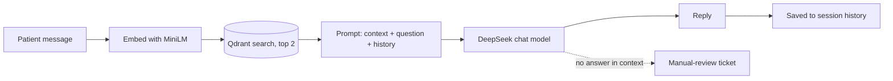

# EZAppointo AI Chatbot

**A RAG support chatbot for a healthcare appointment platform.** It answers patient questions about booking, cancellation, pricing, security and features by searching a vector knowledge base first, then letting an LLM write the reply from that context. When it cannot help, the patient can raise a ticket for manual review.


[**Why**](#why) · [**Features**](#features) · [**How it works**](#how-it-works) · [**Screens**](#screens) · [**API**](#api) · [**Design decisions**](#design-decisions) · [**Tech stack**](#tech-stack) · [**Getting started**](#getting-started) · [**Limits**](#limits)

---

## Why

Appointment platforms get the same questions again and again: how do I book, how do I cancel, is it HIPAA ready, how does pricing work. A generic chatbot invents answers. This project grounds every reply in a curated knowledge base, keeps the replies short and professional, and hands over to a human when the knowledge base has no answer.

> **Why I built it.** *(Write 2-3 lines in your own words here: where the idea came from, what you wanted to learn or prove. This is the part recruiters read first.)*

---

## Features

| | Feature | What it does |
|---|---------|--------------|
| 🔎 | **Retrieval-augmented answers** | Embeds the question, fetches the 2 most relevant knowledge chunks and gives them to the LLM as context |
| 💬 | **Session-based chat** | Each patient gets a session with its own conversation history, so follow-up questions make sense |
| 🧠 | **Editable knowledge base** | Add one entry through the API or bulk-load many with the seed script |
| 🎫 | **Manual-review tickets** | One call creates a ticket with patient name, email and timestamp when the bot cannot help |
| 🐳 | **Container-friendly** | Model, storage and cache paths are configurable and fall back to writable folders on read-only images |
| 📚 | **Focused knowledge chunks** | General info, patient FAQs, feature explanations and roles, one idea per vector, tagged by category |

---

## How it works



1. The patient starts a session with a name and email.
2. Each message is turned into a 384-dimension vector with `all-MiniLM-L6-v2`.
3. Qdrant returns the two closest knowledge entries (cosine similarity).
4. The entries and the question are sent to the LLM along with the chat history and a system prompt that asks for brief, professional answers.
5. Only the patient's original question is stored in the history, not the long context-stuffed prompt, so the history stays small.

---

## Screens

> Add a screenshot of the Swagger UI here. Run `uvicorn main:app --reload` and open `http://127.0.0.1:8000/docs`, then save the image as `docs/swagger.png` and uncomment the line below.

<!--  -->

---

## API

Base path: `/api/v1/chatbot`

| Method | Endpoint | Purpose |
|--------|----------|---------|
| `POST` | `/start-session` | Start a chat for a patient (`name`, `email`) |
| `POST` | `/get-response` | Send a message, get an AI reply (`session_id`, `user_message`) |
| `POST` | `/add-to-knowledge-base` | Add one entry to the knowledge base |
| `POST` | `/create-ticket` | Create a manual-review ticket for a session |

```bash
# 1. Start a session
curl -X POST http://127.0.0.1:8000/api/v1/chatbot/start-session \
  -H "Content-Type: application/json" \
  -d '{"name": "Ali", "email": "ali@example.com"}'

# 2. Ask a question
curl -X POST http://127.0.0.1:8000/api/v1/chatbot/get-response \
  -H "Content-Type: application/json" \
  -d '{"session_id": "session_ali@example.com", "user_message": "How do I cancel my appointment?"}'
```

---

## Design decisions

| Decision | Why |
|----------|-----|
| **Local embedding model** | No per-request embedding cost, no extra API dependency, and it can be baked into a Docker image |
| **Small, single-topic chunks + top 2** | Search returns tight, relevant context instead of one big blob that confuses the LLM |
| **Original question kept in history** | The enriched prompt is swapped back to the plain question after each reply, so context is not repeated turn after turn |
| **Path fallbacks for storage and cache** | If a configured folder is not writable (read-only container), it falls back to a temp directory instead of crashing |
| **Collection created only if missing** | The service can restart safely without wiping or erroring on the knowledge base |
| **System prompt with an escape hatch** | The bot is told to ask for manual review when the context has no answer, instead of guessing |
| **Seed script separate from the API** | Knowledge can be loaded in bulk once, and managed later through the endpoint |

---

## Tech stack


| Layer | Technology |
|-------|------------|
| API | FastAPI, Pydantic |
| LLM | DeepSeek `deepseek-chat` via the OpenAI-compatible SDK |
| Embeddings | `sentence-transformers`, `all-MiniLM-L6-v2` (384 dimensions) |
| Vector database | Qdrant, local on-disk storage, cosine distance |
| Config | `python-dotenv` |

---

## Getting started

```bash
git clone https://github.com/tahaamer786/ezappointo-ai-chatbot.git
cd ezappointo-ai-chatbot

python -m venv venv
source venv/bin/activate        # Windows: venv\Scripts\activate
pip install -r requirements.txt

cp .env.example .env            # then add your own DeepSeek API key

python seed_knowledge_base.py   # load the knowledge base
uvicorn main:app --reload --port 8000
```

Open `http://127.0.0.1:8000/docs` for the interactive API docs.

| Variable | Description |
|----------|-------------|
| `DEEPSEEK_API_KEY` | Your DeepSeek API key (required) |
| `SENTENCE_TRANSFORMER_MODEL_PATH` | Optional local path to the embedding model |
| `CHATBOT_DATA_DIR` | Optional folder for Qdrant storage |
| `HF_CACHE_DIR` | Optional Hugging Face cache folder |

---

## Limits

- **Sessions and tickets live in memory.** They reset when the server restarts. A database such as PostgreSQL or Redis is the next step.
- **No authentication yet.** Endpoints are open and the session id is derived from the email, which is fine for a demo but not for production.
- **Answer quality is not measured.** There is no evaluation set yet, so accuracy has only been checked by hand.
- **Fixed retrieval depth.** It always fetches 2 chunks, so questions that need information from three or more entries may be answered incompletely.
- **Seeding is not idempotent.** Re-running the seed script adds duplicates unless the storage folder is cleared first.
- **Unbounded history.** Long conversations keep growing the prompt, so there is no trimming or summarising yet.

---

## Roadmap

- [ ] Persistent storage for sessions and tickets
- [ ] API authentication and rate limiting
- [ ] Evaluation set to measure answer accuracy
- [ ] Streaming responses
- [ ] Admin page to manage the knowledge base

---

Built by [tahaamer786](https://github.com/tahaamer786)
